# Mô tả hệ thống: Đăng ký, Đăng nhập, Tài khoản

> Dự án IT4409, Nhóm 16. Phần này gồm **Auth Service** (chức năng 1) và **User Service** (chức năng 2).
> Tài liệu mô tả hệ thống qua bốn tầng: frontend, backend, database và bảo mật. Mỗi tác vụ có luồng xử lý chi tiết.
> Các sơ đồ viết bằng Mermaid, GitHub hiển thị trực tiếp. Trong VS Code cần cài extension *Markdown Preview Mermaid Support*.

## Mục lục
1. [Tổng quan](#1-tổng-quan)
2. [Kiến trúc](#2-kiến-trúc)
3. [Frontend](#3-frontend)
4. [Backend](#4-backend)
5. [Database](#5-database)
6. [API](#6-api)
7. [Luồng xử lý các tác vụ](#7-luồng-xử-lý-các-tác-vụ)
8. [Bảo mật](#8-bảo-mật)
9. [Xử lý lỗi](#9-xử-lý-lỗi)
10. [Cấu hình và triển khai](#10-cấu-hình-và-triển-khai)
11. [Kiểm thử](#11-kiểm-thử)
12. [Giới hạn hiện tại và hướng phát triển](#12-giới-hạn-hiện-tại-và-hướng-phát-triển)

---

## 1. Tổng quan

| Chức năng | Người dùng làm được gì | Service xử lý |
|---|---|---|
| **Đăng ký** (`/register`) | Tạo tài khoản bằng email và mật khẩu | Auth Service |
| **Đăng nhập** (`/login`) | Đăng nhập, tuỳ chọn "Ghi nhớ 30 ngày" | Auth Service |
| **Tài khoản** (`/account`), tab Hồ sơ | Xem và sửa họ tên, số điện thoại, ngày sinh | User Service |
| **Tài khoản**, tab Sổ địa chỉ | Thêm, sửa, xoá địa chỉ (tối đa 10), chọn địa chỉ mặc định | User Service |
| **Tài khoản**, tab Bảo mật | Đổi mật khẩu, xem thiết bị đang đăng nhập, đăng xuất từng thiết bị hoặc tất cả | Auth Service |

**Công nghệ**

| Tầng | Công nghệ |
|---|---|
| Frontend | React 18, React Router 6, Vite 6, CSS Sprylo (scope `.sprylo`) |
| Backend | Java 21, Spring Boot 3.5, Spring Security 6 (OAuth2 Resource Server), Spring Data JPA, Bean Validation |
| Database | PostgreSQL 17, mỗi service một database. Migration bằng Flyway. Dev và test dùng H2 |
| Bảo mật | JWT RS256 (Nimbus JOSE), Argon2id (BouncyCastle), AES-256-GCM (JCA) |
| Triển khai | Docker, Docker Compose |

**Nguyên tắc thiết kế**
- **Database-per-service:** Auth và User có database riêng, không dùng khoá ngoại xuyên service. Hai service liên kết với nhau bằng `userId`, chính là claim `sub` trong JWT.
- **Stateless:** server không lưu session. Mỗi request mang access token và tự chứng minh danh tính.
- **Defense in depth:** mỗi lớp (trình duyệt, filter, controller, service, database) đều có kiểm tra riêng, không phụ thuộc lớp trước.
- **Mặc định từ chối:** endpoint nào không khai báo công khai thì bắt buộc đăng nhập.

---

## 2. Kiến trúc

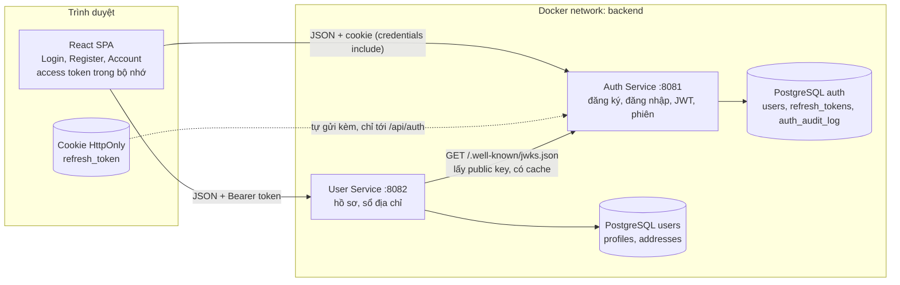

- **Auth Service** là nơi duy nhất giữ **private key** và ký JWT.
- **User Service** (và mọi service khác của nhóm) chỉ có **public key**, lấy qua JWKS. Nó kiểm được token nhưng không tự tạo token được.
- PostgreSQL **không mở cổng** ra máy host. Hai service chỉ bind vào `127.0.0.1`. Khi có API Gateway thì chỉ Gateway được lộ ra ngoài.

### Hai loại token

| | Access token | Refresh token |
|---|---|---|
| Dạng | JWT ký RS256 | Chuỗi ngẫu nhiên 256 bit (không phải JWT) |
| Thời hạn | 15 phút | Hết phiên trình duyệt, hoặc 30 ngày nếu tick "Ghi nhớ". Đây là hạn tuyệt đối |
| Lưu ở client | Biến JS trong bộ nhớ (`authApi.js`) | Cookie `HttpOnly; Secure; SameSite=Strict; Path=/api/auth` |
| Lưu ở server | Không lưu | Bảng `refresh_tokens`, chỉ lưu SHA-256 |
| Gửi đi | Header `Authorization: Bearer …` | Trình duyệt tự gửi kèm khi gọi `/api/auth/*` |
| Thu hồi | Không thu hồi được, hết hạn sau 15 phút. Riêng Auth Service còn từ chối token cấp trước lần đổi mật khẩu | Thu hồi ngay bằng cách đánh dấu `revoked_at` |

---

## 3. Frontend

### 3.1 Cấu trúc file

```
frontend/src/
├── pages/
│   ├── Login.jsx          Form đăng nhập, "Ghi nhớ", chuyển hướng an toàn theo ?next=
│   ├── Register.jsx       Form đăng ký, kiểm tra từng ô, thanh đo độ mạnh mật khẩu
│   └── Account.jsx        3 tab: Hồ sơ, Sổ địa chỉ (dialog thêm/sửa), Bảo mật
├── components/
│   ├── SpryloLayout.jsx   Header, menu, drawer mobile, footer (dùng <Link>, không tải lại trang)
│   ├── PasswordInput.jsx  Ô mật khẩu có nút HIỆN/ẨN
│   └── Alert.jsx          Thông báo, render qua {} nên được escape tự động
├── services/
│   ├── authApi.js         Giữ access token, tự refresh, đồng bộ đăng xuất giữa các tab
│   └── userApi.js         Gọi User Service, dùng chung token và cơ chế refresh với authApi
├── utils/security.js      safeNext (chống open redirect), passwordStrength, describeDevice
└── styles/sprylo.css, auth.css   (mọi selector có tiền tố .sprylo)
```

### 3.2 Quản lý phiên phía trình duyệt (`authApi.js`)

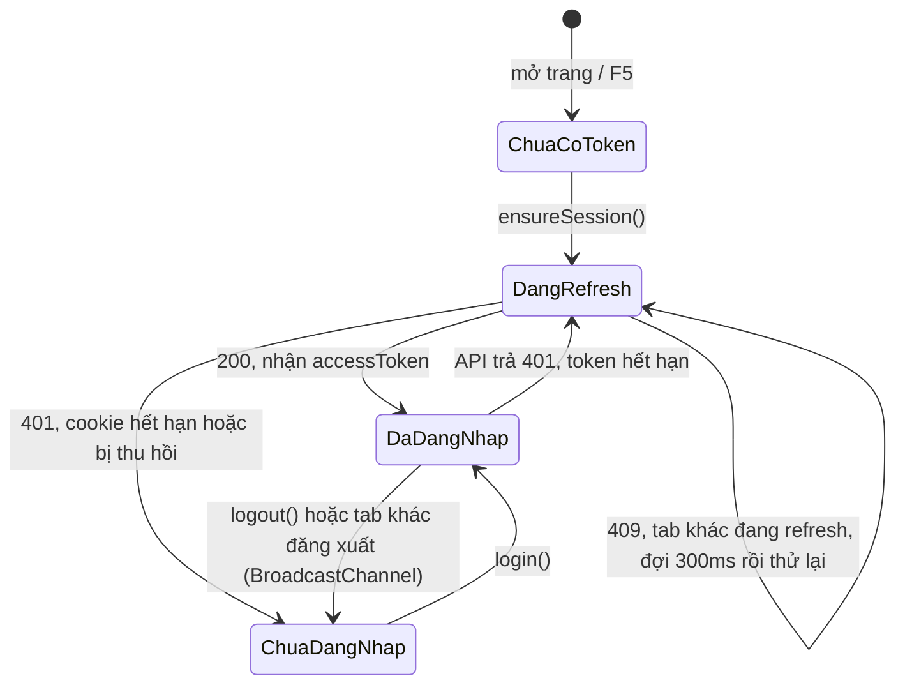

| Kỹ thuật | Lý do |
|---|---|
| Access token chỉ nằm trong biến JS | Nếu trang dính XSS, script độc đọc được `localStorage` nhưng không đọc được biến nội bộ của module |
| Gộp các lời gọi `/refresh` đồng thời thành một Promise | Hai lần refresh song song cùng một cookie sẽ bị server coi là "dùng lại token" và thu hồi cả phiên. React StrictMode chạy `useEffect` hai lần nên rất dễ gặp lỗi này |
| `credentials: "include"` chỉ khi gọi Auth Service | Cookie refresh không cần (và không nên) đi tới service khác |
| `BroadcastChannel("sprylo-auth")` | Đăng xuất ở một tab thì các tab khác cũng xoá token |
| `safeNext()` | Chặn `/login?next=https://evil.com`. Chỉ cho phép đường dẫn nội bộ bắt đầu bằng `/`, không chấp nhận `//` |
| `e.preventDefault()` trong mọi `onSubmit` | Nếu thiếu, form sẽ submit kiểu GET và mật khẩu hiện trên URL, lịch sử trình duyệt, log server |
| Không dùng `dangerouslySetInnerHTML` | React escape mọi giá trị trong `{}`. Dữ liệu từ server (tên, địa chỉ, User-Agent) không chèn được HTML |
| Truyền email qua `navigate(..., {state})`, không qua URL | Email không bị lưu vào lịch sử trình duyệt hay log |

### 3.3 Hành vi từng trang

| Trang | Khi mở | Khi submit | Thành công | Thất bại |
|---|---|---|---|---|
| Login | `ensureSession()`: nếu còn phiên thì chuyển ngay tới `next` | Kiểm tra form, gọi `login()` | Chuyển tới `safeNext(next)` (mặc định `/account`) | Hiện thông báo của server, xoá ô mật khẩu, focus lại ô đó |
| Register | Chỉ đặt tiêu đề trang | Kiểm tra email, độ dài mật khẩu, mật khẩu nhập lại, điều khoản. Gọi `register()` | Chuyển tới `/login` kèm email điền sẵn và thông báo | Hiện danh sách lỗi chính sách mật khẩu từ server |
| Account | `ensureSession()`. Nếu không có phiên thì chuyển `/login?next=/account`, nếu có thì gọi `GET /api/auth/me` | Tuỳ tab (mục 7.5 đến 7.9) | Hiện alert thành công, tải lại dữ liệu | Hiện alert lỗi. Gặp 401 sau khi đã refresh thì về trang login |

> Kiểm tra ở trình duyệt **chỉ để cải thiện trải nghiệm**. Server luôn kiểm tra lại toàn bộ, vì ai cũng gọi API thẳng bằng curl được.

---

## 4. Backend

### 4.1 Các lớp xử lý một request

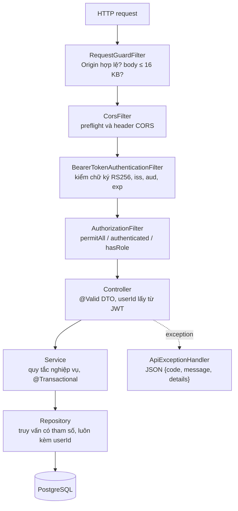

### 4.2 Auth Service (`backend/auth-service`)

| Package / file | Vai trò |
|---|---|
| `web/AuthController` | Endpoint `/api/auth/*`, đặt và xoá cookie refresh, gọi rate limiter |
| `web/JwksController` | `GET /.well-known/jwks.json`, chỉ công bố public key |
| `AuthService` | Nghiệp vụ: register, login, refresh, logout, logoutAll, changePassword, sessions, revokeSession, requireActiveUser |
| `token/AccessTokenService` | Ký JWT (claims `iss, aud, sub, roles, iat, exp, jti`) |
| `token/RefreshTokenService` | Tạo, xoay vòng, thu hồi refresh token, phát hiện tái sử dụng |
| `security/PasswordPolicy` | Chính sách mật khẩu theo NIST 800-63B, chuẩn hoá Unicode NFKC |
| `security/LoginAttemptService` | Khoá tạm theo tài khoản, thời gian khoá tăng dần |
| `security/RateLimiter` | Giới hạn số request theo IP |
| `security/RequestGuardFilter` | Kiểm Origin (chống CSRF), giới hạn kích thước body |
| `audit/AuditService` | Ghi nhật ký bảo mật trong transaction riêng (`REQUIRES_NEW`) |
| `config/SecurityConfig` | Filter chain, Argon2id, CORS, header bảo mật |
| `config/JwtKeyConfig` | Nạp hoặc sinh khoá RSA 3072 bit, JwtEncoder và JwtDecoder |

### 4.3 User Service (`backend/user-service`)

| Package / file | Vai trò |
|---|---|
| `web/UserController` | `/api/users/me`, `/api/users/me/addresses/*`, `/api/admin/users` |
| `profile/ProfileService` | Tạo hồ sơ ở lần truy cập đầu (lazy create), cập nhật, kiểm tra ngày sinh, phân trang cho admin |
| `address/AddressService` | Thêm, sửa, xoá địa chỉ, chọn mặc định, giới hạn 10 địa chỉ (có khoá dòng) |
| `address/AddressRepository` | Mọi truy vấn đều có điều kiện `userId` |
| `crypto/PiiCipher` | Mã hoá và giải mã AES-256-GCM |
| `crypto/EncryptedStringConverter` | JPA converter: tự mã hoá khi ghi xuống DB, giải mã khi đọc lên |
| `security/CurrentUser` | Lấy `userId` từ `jwt.getSubject()` |
| `web/dto/Inputs` | Allowlist regex, chuẩn hoá số điện thoại, che số điện thoại |
| `config/SecurityConfig` | Resource server: JWKS, chỉ RS256, kiểm iss và aud, `/api/admin/**` cần `ADMIN` |

---

## 5. Database

### 5.1 Database `auth` (Auth Service)

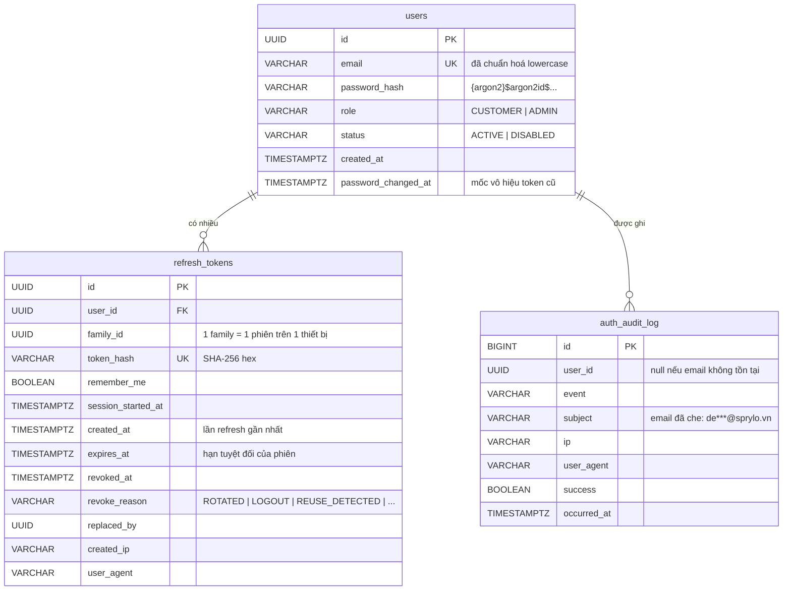

**Vòng đời một family refresh token**

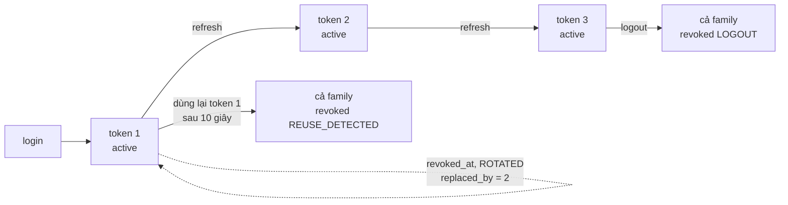

### 5.2 Database `users` (User Service)

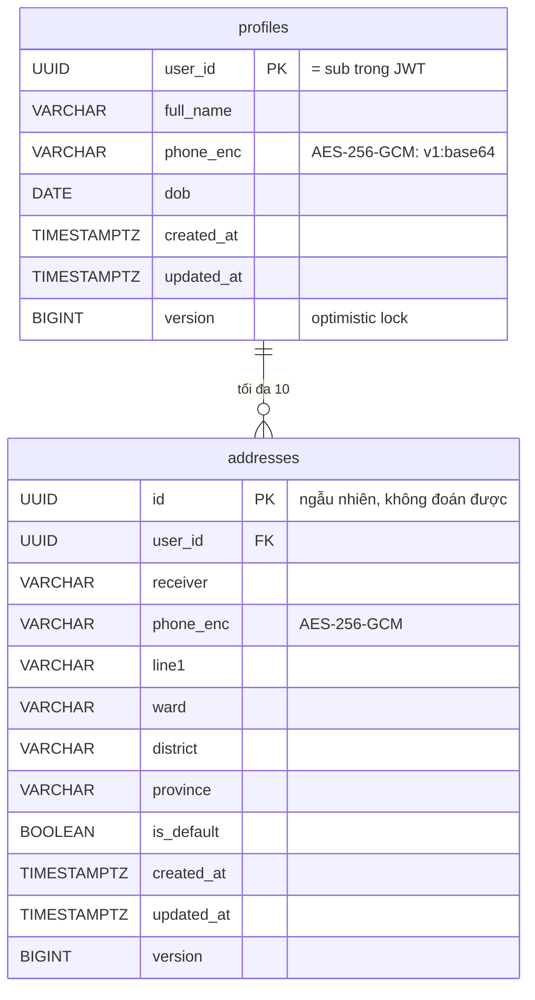

### 5.3 Ràng buộc và index

| Đối tượng | Mục đích |
|---|---|
| `uq_users_email` (UNIQUE) | Không thể có hai tài khoản trùng email, kể cả khi hai request đăng ký chạy song song |
| `ck_users_role`, `ck_users_status` (CHECK) | DB từ chối giá trị role và status không hợp lệ |
| `uq_refresh_tokens_hash` + tra cứu theo hash | Tìm token nhanh mà không lưu bản gốc |
| `idx_refresh_tokens_user`, `idx_refresh_tokens_family` | Thu hồi theo người dùng hoặc theo phiên |
| `idx_addresses_user` | Mọi truy vấn địa chỉ đều lọc theo `user_id` |
| `uq_addresses_one_default` (partial unique index, chỉ PostgreSQL) | Mỗi người **tối đa một** địa chỉ mặc định, do DB bảo đảm |
| `addresses.user_id → profiles` `ON DELETE CASCADE` | Xoá hồ sơ thì xoá luôn địa chỉ |
| Cột `version` | Optimistic locking: hai request sửa cùng lúc thì request sau nhận 409, không ghi đè âm thầm |

### 5.4 Migration
Schema do **Flyway** quản lý (`src/main/resources/db/migration/V1__init.sql`). Hibernate chỉ kiểm tra cho khớp (`ddl-auto: validate`), không tự sinh bảng. User Service có thêm `db/vendor/postgresql/V2__one_default_address.sql`, chỉ chạy trên PostgreSQL.

---

## 6. API

Mọi lỗi trả về có dạng `{"code": "...", "message": "...", "details": ["..."]}`.

### 6.1 Auth Service (`http://localhost:8081`)

| Method | Path | Xác thực | Body | Thành công | Lỗi chính |
|---|---|---|---|---|---|
| POST | `/api/auth/register` | — | `{email, password}` | **202** `{message}`, cùng nội dung cho mọi email | 400 `VALIDATION_FAILED`, `WEAK_PASSWORD`, `MALFORMED_REQUEST` · 429 |
| POST | `/api/auth/login` | — | `{email, password, rememberMe}` | **200** `{accessToken, tokenType, expiresIn}` + `Set-Cookie` | 401 `INVALID_CREDENTIALS` · 429 |
| POST | `/api/auth/refresh` | cookie | — | **200** như login, kèm cookie mới | 401 `INVALID_REFRESH_TOKEN` (xoá cookie) · 409 `REFRESH_IN_PROGRESS` |
| POST | `/api/auth/logout` | cookie | — | **204**, xoá cookie | — |
| POST | `/api/auth/logout-all` | Bearer | — | **204**, xoá cookie | 401 |
| GET | `/api/auth/me` | Bearer | — | **200** `{id, email, role, createdAt, passwordChangedAt}` | 401 `TOKEN_REVOKED` |
| POST | `/api/auth/change-password` | Bearer | `{currentPassword, newPassword}` | **204**, xoá cookie | 400 `INVALID_CURRENT_PASSWORD`, `SAME_PASSWORD`, `WEAK_PASSWORD` · 429 |
| GET | `/api/auth/sessions` | Bearer (+cookie) | — | **200** `[{id, current, startedAt, lastActiveAt, expiresAt, ip, userAgent, rememberMe}]` | 401 |
| DELETE | `/api/auth/sessions/{id}` | Bearer | — | **204** | 404 `SESSION_NOT_FOUND` |
| GET | `/.well-known/jwks.json` | — | — | **200** `{keys:[{kty, e, n, kid}]}` | — |

### 6.2 User Service (`http://localhost:8082`)

| Method | Path | Xác thực | Body | Thành công | Lỗi chính |
|---|---|---|---|---|---|
| GET | `/api/users/me` | Bearer | — | **200** `{fullName, phone, dob, updatedAt}` | 401 |
| PUT | `/api/users/me` | Bearer | `{fullName?, phone?, dob?}` | **200** hồ sơ đã chuẩn hoá | 400 `VALIDATION_FAILED`, `INVALID_DOB`, `MALFORMED_REQUEST` · 409 `CONCURRENT_UPDATE` |
| GET | `/api/users/me/addresses` | Bearer | — | **200** `[{id, receiver, phone, line1, ward, district, province, isDefault}]`, địa chỉ mặc định đứng đầu | 401 |
| POST | `/api/users/me/addresses` | Bearer | `{receiver, phone, line1, ward, district, province, isDefault}` | **201** địa chỉ | 400 · 409 `ADDRESS_LIMIT` |
| PUT | `/api/users/me/addresses/{id}` | Bearer | như POST | **200** | 400 · 404 `ADDRESS_NOT_FOUND` |
| PATCH | `/api/users/me/addresses/{id}/default` | Bearer | — | **200** | 404 |
| DELETE | `/api/users/me/addresses/{id}` | Bearer | — | **204** | 404 |
| GET | `/api/admin/users?page&size` | Bearer **ADMIN** | — | **200** `{items:[{userId, fullName, phoneMasked, createdAt}], page, size≤50, total}` | 403 `FORBIDDEN` |

---

## 7. Luồng xử lý các tác vụ

### 7.1 Đăng ký

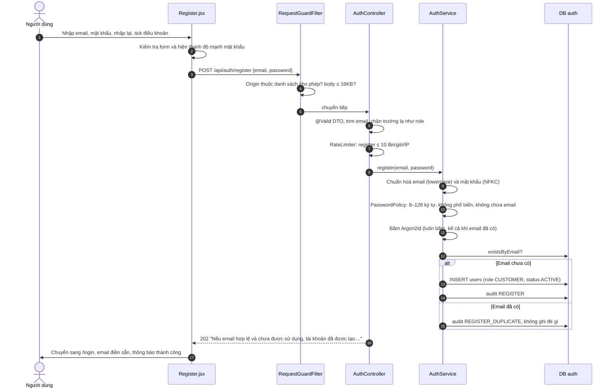

**Điểm bảo mật:** phản hồi và thời gian xử lý như nhau dù email đã tồn tại hay chưa, để chống dò tài khoản. Role luôn là `CUSTOMER`. Nếu hai request đăng ký trùng email chạy song song, `UNIQUE` constraint chặn bản thứ hai.

### 7.2 Đăng nhập

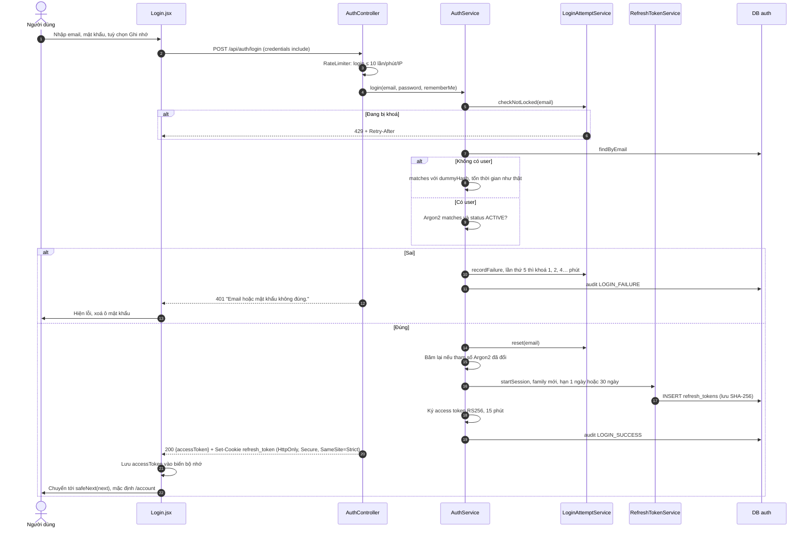

### 7.3 Khôi phục phiên (F5, mở tab mới) và xoay vòng refresh token

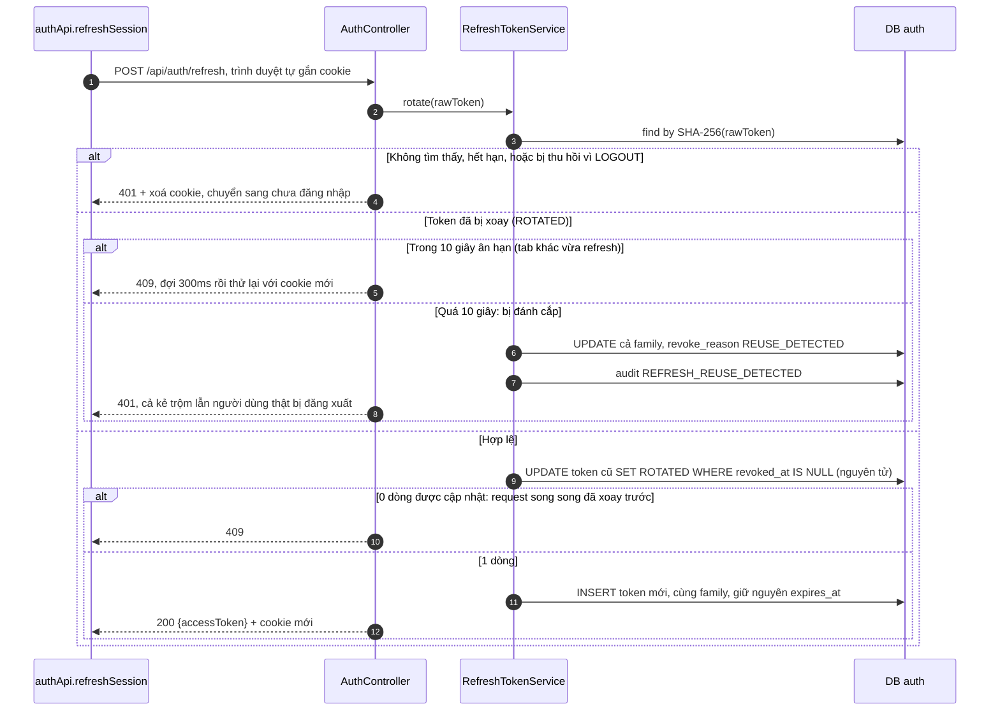

### 7.4 Gọi API có token và tự refresh khi hết hạn

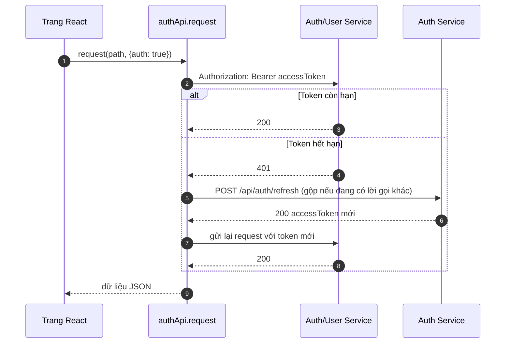

User Service kiểm token **hoàn toàn tại chỗ**: kiểm chữ ký bằng public key đã cache từ JWKS, rồi kiểm `iss = g16-auth-service`, `aud ∋ g16-api` và `exp`. Nó không gọi Auth Service ở mỗi request.

### 7.5 Mở trang Tài khoản

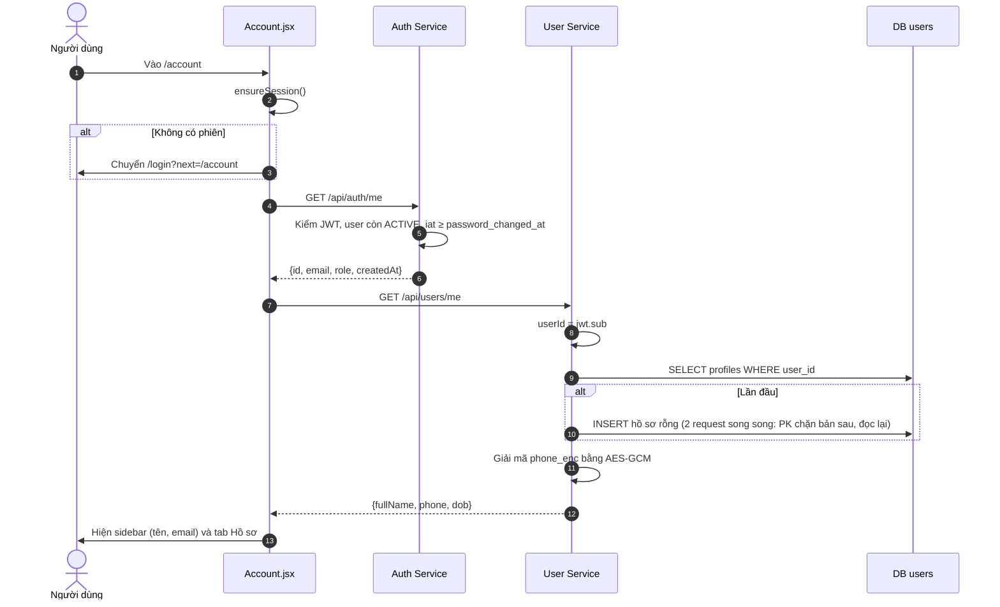

### 7.6 Cập nhật hồ sơ

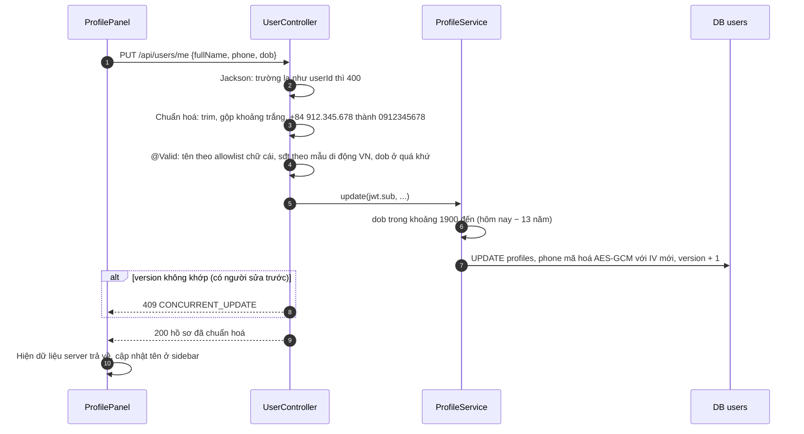

### 7.7 Thêm địa chỉ

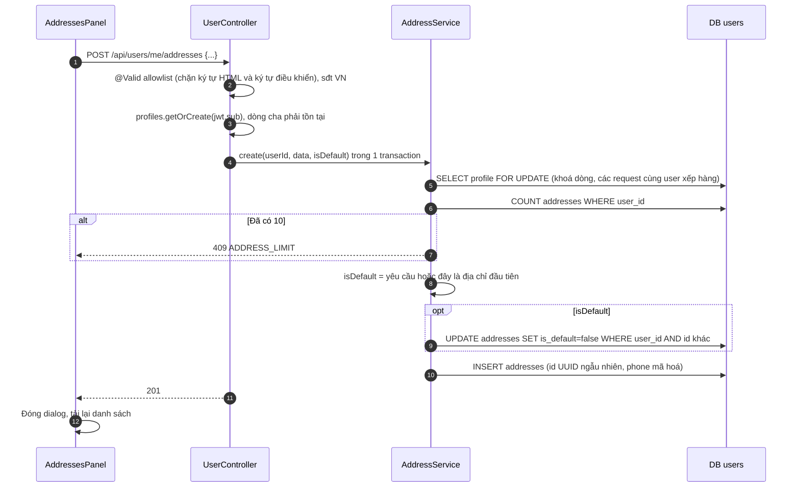

### 7.8 Sửa, xoá, chọn mặc định địa chỉ (chống IDOR)

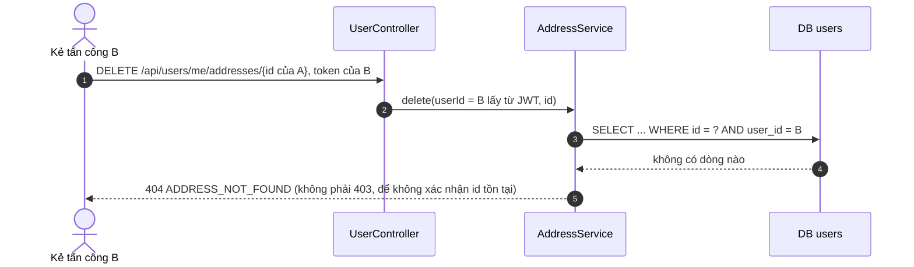

- **Sửa:** tìm theo `(id, userId)`, áp dụng dữ liệu mới. Nếu đặt làm mặc định thì bỏ cờ mặc định của các địa chỉ khác trước.
- **Xoá:** nếu xoá đúng địa chỉ mặc định thì địa chỉ cũ nhất còn lại tự thành mặc định.
- **Chọn mặc định:** `PATCH …/{id}/default`, cùng nguyên tắc tìm theo `(id, userId)`.

### 7.9 Đổi mật khẩu

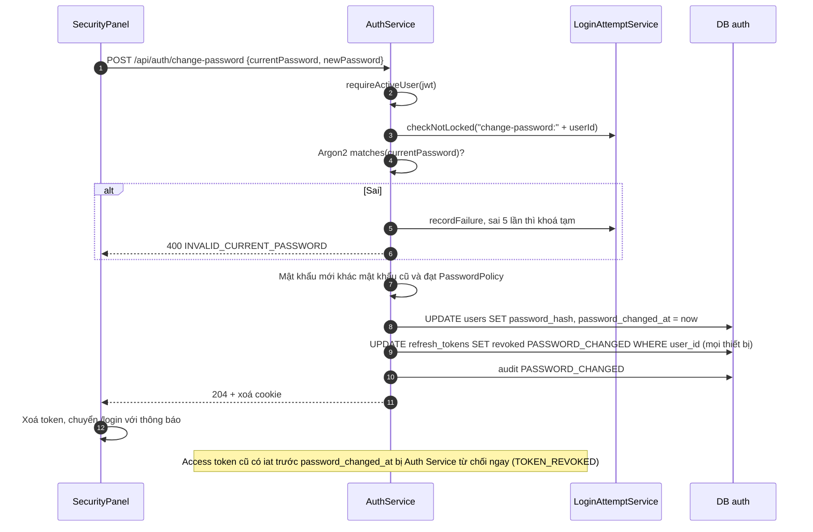

### 7.10 Đăng xuất, đăng xuất tất cả, đăng xuất một thiết bị

| Tác vụ | Request | Xử lý ở server | Kết quả |
|---|---|---|---|
| Đăng xuất | `POST /api/auth/logout` (cookie) | Tìm token theo hash, thu hồi cả family (`LOGOUT`) | Cookie bị xoá. BroadcastChannel báo các tab khác |
| Đăng xuất tất cả | `POST /api/auth/logout-all` (Bearer) | `UPDATE refresh_tokens … WHERE user_id` (`LOGOUT_ALL`) | Mọi thiết bị phải đăng nhập lại khi access token hết hạn |
| Đăng xuất một thiết bị | `DELETE /api/auth/sessions/{familyId}` (Bearer) | `UPDATE … WHERE family_id = ? AND user_id = ?`, 0 dòng thì trả 404 | Thiết bị đó không refresh được nữa |
| Danh sách thiết bị | `GET /api/auth/sessions` (Bearer + cookie) | Token đang active của user. So `family_id` với cookie để đánh dấu "thiết bị này" | Hiện trình duyệt, hệ điều hành, IP, thời điểm đăng nhập và lần hoạt động cuối |

---

## 8. Bảo mật

### 8.1 Bảo mật theo tầng

| Tầng | Biện pháp |
|---|---|
| **Frontend** | Token chỉ trong bộ nhớ. Không dùng `innerHTML`. `safeNext` chống open redirect. `preventDefault` cho mọi form. `autocomplete` đúng chuẩn (`current-password`, `new-password`) để trình quản lý mật khẩu hoạt động. Kiểm tra form sớm (chỉ phục vụ trải nghiệm) |
| **Truyền tải** | Cookie `Secure`. HTTPS khi triển khai thật (qua Gateway). CORS chỉ cho origin của frontend, không dùng `*` |
| **Filter** | `RequestGuardFilter`: kiểm Origin cho mọi request không phải GET, body ≤ 16 KB. Header `CSP: default-src 'none'`, `X-Frame-Options: DENY`, `nosniff`, `Referrer-Policy: no-referrer`, `Cache-Control: no-store` |
| **Xác thực** | Argon2id. JWT RS256 với kiểm tra iss, aud, exp và đúng thuật toán. Refresh token ngẫu nhiên, xoay vòng, phát hiện tái sử dụng |
| **Phân quyền** | Mặc định cần đăng nhập. `userId` lấy từ JWT. `/api/admin/**` kiểm hai lớp (theo URL và `@PreAuthorize`) |
| **Đầu vào** | DTO record chỉ có trường được phép, `fail-on-unknown-properties`, Bean Validation, allowlist regex, chuẩn hoá trước khi validate, `consumes=application/json` |
| **Nghiệp vụ** | Khoá tài khoản tạm thời, rate limit theo IP, giới hạn 10 địa chỉ (có khoá dòng), giới hạn kích thước trang |
| **Database** | Truy vấn có tham số (không có SQL injection). UNIQUE, CHECK, partial unique index. Optimistic lock. Mã hoá số điện thoại bằng AES-256-GCM. Chỉ lưu hash của mật khẩu và token. Mỗi service một DB |
| **Log và lỗi** | Audit log riêng. Che email và số điện thoại. Lọc ký tự điều khiển. Không log mật khẩu, token. Không trả stack trace |
| **Hạ tầng** | DB không mở cổng ra host. Container chạy user thường, `read_only`, `cap_drop: ALL`, `no-new-privileges`. Secret nằm trong `.env` (đã gitignore) |

### 8.2 Bảng mối đe doạ → biện pháp → kiểm chứng

| # | Tấn công (OWASP) | Biện pháp | Test tự động |
|---|---|---|---|
| 1 | Credential stuffing, brute force (API2, A07) | Khoá theo tài khoản và rate limit theo IP | `lockoutAfterRepeatedFailures`, `rateLimiterBlocksBursts` |
| 2 | Dò tài khoản (A07) | Cùng thông điệp và thời gian, khoá cả email không tồn tại | `sameErrorForUnknownEmailAndWrongPassword`, `registerDoesNotRevealExistingEmail`, `lockoutAlsoAppliesToUnknownEmails` |
| 3 | Lộ DB làm lộ mật khẩu (A02) | Argon2id, salt riêng cho từng mật khẩu | `passwordStoredAsArgon2` |
| 4 | Mật khẩu yếu (A07) | NIST 800-63B, danh sách mật khẩu phổ biến | `weakPasswordsRejected` |
| 5 | Giả mạo JWT (API2, A02) | Chỉ RS256, kiểm iss, aud, exp | `algNoneRejected`, `algorithmConfusionRejected`, `tamperedPayloadRejected`, `foreignKeyRejected`, `wrongAudienceRejected` (cả hai service) |
| 6 | Lộ private key | JWKS chỉ có public key | `jwksNeverLeaksPrivateKey` |
| 7 | Đánh cắp refresh token (A07) | HttpOnly cookie, xoay vòng, phát hiện tái sử dụng, hạn tuyệt đối | `reuseOfRotatedTokenRevokesFamily`, `rotationDoesNotExtendSession` |
| 8 | Token cũ sau khi đổi mật khẩu | Thu hồi mọi phiên và kiểm `iat` | `changePasswordRevokesEverything` |
| 9 | CSRF, login CSRF (A01) | SameSite=Strict, kiểm Origin, chỉ nhận JSON | `foreignOriginRejected`, `htmlFormRejected` |
| 10 | **IDOR/BOLA** (API1, xếp hạng 1) | `userId` lấy từ JWT, truy vấn `WHERE id AND user_id`, trả 404 | `cannotRevokeOtherUsersSession`, `cannotTouchOtherUsersAddress` |
| 11 | Mass assignment (API3) | DTO cùng `fail-on-unknown-properties` | `cannotSelfAssignRole`, `cannotOverrideUserId` |
| 12 | Leo thang quyền (API5) | `hasRole('ADMIN')` hai lớp | `adminEndpoint` |
| 13 | XSS lưu trữ (A03) | Allowlist ở server và escape bằng React khi hiển thị | `addressAllowlist`, `profileValidation` |
| 14 | Lộ PII khi lộ DB hoặc backup (A02) | AES-256-GCM, IV ngẫu nhiên. Admin chỉ thấy số đã che | `phoneEncryptedAtRest`, `adminEndpoint` |
| 15 | Tiêu tốn tài nguyên (API4) | Body ≤ 16 KB, `@Size`, trang ≤ 50 dòng, tối đa 10 địa chỉ | `hugeBodyRejected`, `addressLimit`, `adminEndpoint` (size=100000 bị chặn còn 50) |
| 16 | Race condition (TOCTOU) | UPDATE có điều kiện nguyên tử, `SELECT FOR UPDATE`, UNIQUE, version | `reuseOfRotatedTokenRevokesFamily` (409), `addressLimit` |
| 17 | Lộ thông tin qua lỗi (A05) | `ApiExceptionHandler`, `include-stacktrace: never` | `securityHeaders`, `noLeaks` |
| 18 | Log injection (A09) | Lọc ký tự điều khiển trong User-Agent, chuẩn hoá khoảng trắng | `addressAllowlist` (CR/LF) |

### 8.3 Quản lý bí mật

| Bí mật | Nơi lưu | Nếu bị lộ |
|---|---|---|
| Private key RSA ký JWT | `AUTH_JWT_PRIVATE_KEY_LOCATION`, gắn vào container qua Docker secret. Nếu chưa cấu hình thì sinh khoá tạm khi khởi động | Kẻ tấn công tự cấp token ADMIN. Phải đổi khoá ngay; mọi token cũ mất hiệu lực |
| `USER_PII_KEY` (AES-256) | `.env`, không commit | Giải mã được số điện thoại trong DB. **Nếu mất khoá thì mất luôn dữ liệu đã mã hoá** |
| Mật khẩu DB | `.env` | Truy cập trực tiếp DB, nhưng DB không mở cổng ra ngoài |

---

## 9. Xử lý lỗi

| HTTP | Khi nào | Frontend xử lý |
|---|---|---|
| 400 | Dữ liệu sai, gồm cả `details[]` liệt kê từng lỗi | Hiện thông điệp và danh sách lỗi |
| 401 | Thiếu token, token sai hoặc hết hạn, sai mật khẩu | `request()` tự refresh một lần. Thất bại thì về `/login` |
| 403 | Origin lạ, không đủ quyền | Hiện thông điệp |
| 404 | Không tìm thấy, **hoặc tài nguyên không thuộc về bạn** | Hiện thông điệp, tải lại danh sách |
| 409 | `ADDRESS_LIMIT`, `CONCURRENT_UPDATE`, `REFRESH_IN_PROGRESS` | Hiện thông điệp. Riêng refresh thì tự thử lại |
| 413 / 415 | Body quá lớn, sai Content-Type | Không xảy ra khi dùng giao diện |
| 429 | Khoá tài khoản hoặc vượt rate limit, kèm header `Retry-After` | Hiện "thử lại sau N giây" |
| 0 (network) | Service chưa chạy | "Không kết nối được máy chủ…" |

---

## 10. Cấu hình và triển khai

### 10.1 Cổng và biến môi trường

| Service | Cổng | Biến quan trọng |
|---|---|---|
| auth-service | 8081 | `DB_URL`, `DB_USER`, `DB_PASSWORD`, `AUTH_ALLOWED_ORIGINS`, `AUTH_JWT_PRIVATE_KEY_LOCATION`, `AUTH_COOKIE_SECURE` |
| user-service | 8082 | `DB_URL`, `DB_USER`, `DB_PASSWORD`, `AUTH_JWKS_URI`, `USER_ALLOWED_ORIGINS`, **`USER_PII_KEY`** (bắt buộc) |
| frontend (Vite) | 5173 | `VITE_AUTH_API_URL` (mặc định `http://localhost:8081`), `VITE_USER_API_URL` (mặc định `http://localhost:8082`) |

**Tham số bảo mật** (`application.yml`): access token 15 phút · phiên 1 ngày, hoặc 30 ngày nếu tick "Ghi nhớ" · ân hạn refresh 10 giây · khoá sau 5 lần sai trong 15 phút, khoá 1 phút nhân đôi mỗi lần, tối đa 15 phút · rate limit login 10/phút, register 10/giờ, refresh 30/phút theo IP · tối đa 10 địa chỉ.

### 10.2 Chạy bằng Docker (đầy đủ)
```bash
cp .env.example .env
# Sửa .env: AUTH_DB_PASSWORD, USER_DB_PASSWORD, USER_PII_KEY (openssl rand -base64 32)
docker compose up -d --build
cd frontend && npm install && npm run dev      # http://localhost:5173
```

### 10.3 Chạy không cần Docker (H2, để phát triển)
```bash
cd backend/auth-service && ./mvnw spring-boot:run -Dspring-boot.run.profiles=local
cd backend/user-service && ./mvnw spring-boot:run -Dspring-boot.run.profiles=local
```

---

## 11. Kiểm thử

| Bộ test | Số test | Lệnh |
|---|---|---|
| `auth-service/.../AuthSecurityTest` | 31 | `cd backend/auth-service && ./mvnw test` |
| `user-service/.../UserSecurityTest` | 14 | `cd backend/user-service && ./mvnw test` |

Test dùng H2 in-memory và đồng hồ tua được (`MutableClock`) để kiểm tra khoá tài khoản và thời hạn mà không phải chờ thật. User Service tự ký JWT bằng khoá RSA riêng của test, qua đúng bộ validator của code thật.

**Kiểm thử end-to-end đã chạy** với hai service thật kết nối qua JWKS:
- đăng ký, đăng nhập, `/me`
- cập nhật hồ sơ (`+84 912 345 678` thành `0912345678`)
- thêm địa chỉ (tự thành mặc định)
- tài khoản khác xoá địa chỉ thì nhận **404**, địa chỉ vẫn còn
- token bị sửa chữ ký thì nhận **401**
- preflight CORS chỉ chấp nhận `http://localhost:5173`

---

## 12. Giới hạn hiện tại và hướng phát triển

| Hạng mục | Hiện tại | Hướng phát triển |
|---|---|---|
| Xác thực email, quên mật khẩu | Chưa có | Token một lần, hết hạn sau 15 phút, gửi qua Notification Service |
| Rate limit và lockout | Lưu trong RAM, chỉ đúng khi chạy một instance | Chuyển sang Redis |
| Khoá JWT | Sinh tạm nếu chưa cấu hình | Dùng Docker secret cố định, xoay khoá theo `kid` |
| Access token sau đổi mật khẩu ở **User Service** | Còn hiệu lực tối đa 15 phút | Chấp nhận được, hoặc thêm danh sách token bị thu hồi qua Redis |
| API Gateway | Chưa có, frontend gọi thẳng từng service | Spring Cloud Gateway: một origin, HTTPS, rate limit tập trung |
| Mã hoá PII | Chưa gắn ngữ cảnh: có thể hoán đổi ciphertext giữa các dòng | Dùng AAD là `user_id` trong AES-GCM, kèm cơ chế xoay khoá theo tiền tố `v1:` |
| 2FA | Chưa có | TOTP (Google Authenticator) |
| Xoá tài khoản (quyền được lãng quên) | Chưa có | Phát sự kiện `user.deleted` để các service xoá dữ liệu liên quan |
| Search Service (chức năng 9) | Chưa làm | Elasticsearch, query có kiểu, whitelist sort, giới hạn `size` |
